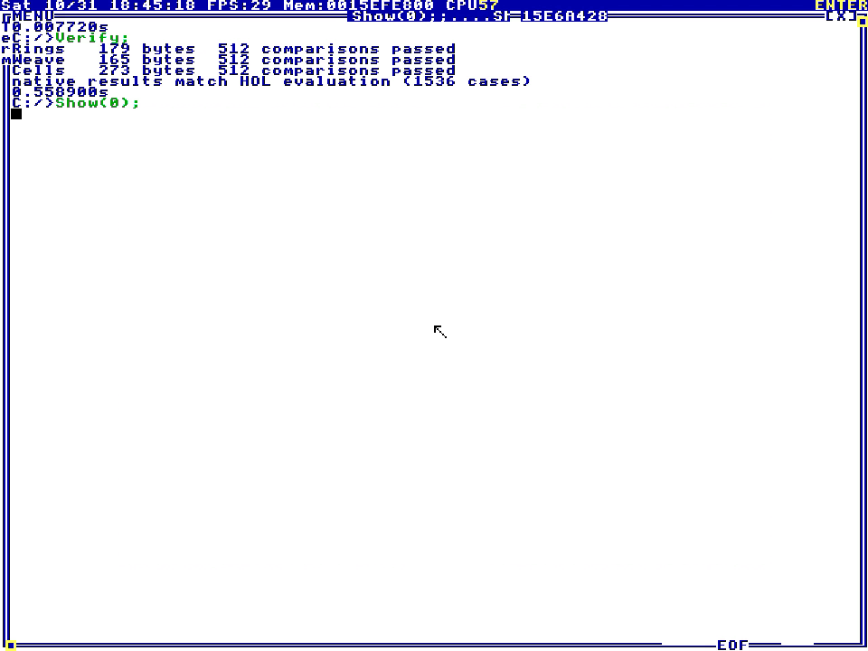
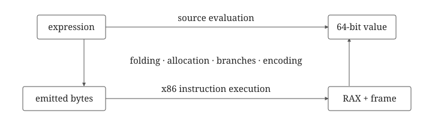

Pixel expressions compile to native x86+64 for TempleOS through a compiler implemented in Isabelle/HOL with proofs of constant folding, lexical slot allocation, bounded stack execution and correspondence with a register and stack model

[](media/demo.mp4)

## Build

```sh
make check
make payload
```

It uses:
- Isabelle2026 and its bundled Poly/ML toolchain 
- Python

Copy these files onto `C:/` in TempleOS and run:

```c
#include "C:/Remy.HC";
Verify;
Show(0);
```

## Correctness

Each `let` pushes a binding onto the evaluation stack. [Compilation](src/core/Compiler.thy) adjusts variable offsets as intermediate values accumulate above those bindings and proves that execution leaves the result followed by the original stack whereas accepted programs stay within 512 evaluation words at every instruction boundary

[Native lowering](src/core/Native.thy) puts the result in `rax` and preserves `r8`, `r9` and `rdx` which carry `x`, `y` and `t`. The temporary registers are `rax`, `rcx` and `rbx` while the [Encoding](src/core/Encoding.thy) proves decoder inversion and byte bounds for the emitted blocks including their immediate operands and stack displacements



Arithmetic wraps modulo `2^64` and shifts mask their count to six bits

Both branches of a nonconstant conditional run before selection which preserves the result because expressions have no side effects. The HolyC runner masks each pixel result to four bits for the TempleOS palette

The execution theorem is relative to the instruction block model. Actual x86 execution + the HolyC calling bridge and the extracted runtime and the OS are outside its scope. Tests compare emitted code against an independent evaluator on Linux and against HOL results inside the recorded TempleOS guest
